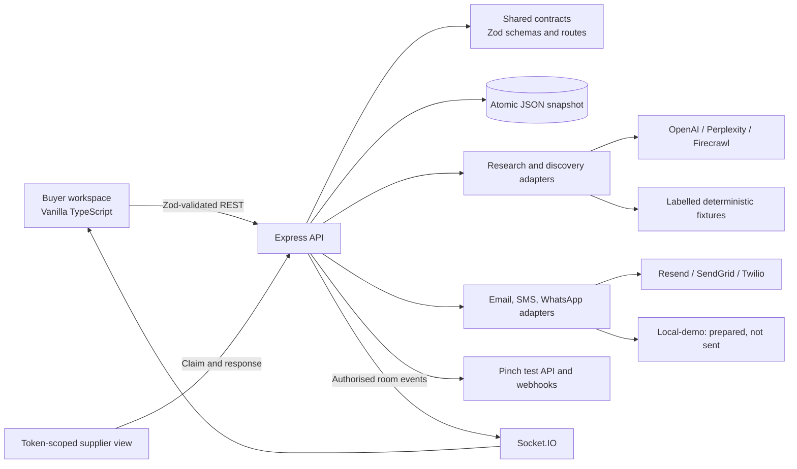

# Veltact

Veltact is an AI-assisted industrial sourcing and deployment workflow. It turns a factory problem into a buyer-reviewed Need Profile, cited solution pathways, explainable supplier matches, controlled outreach, comparable quotes, a Pinch commitment, and visible delivery milestones.

The project was built for the Pinch hackathon, but its engineering scope goes beyond a landing-page prototype: a TypeScript monorepo, shared runtime contracts, token-scoped buyer and supplier capabilities, provider adapters, auditable state transitions, deterministic demo fixtures, real-time updates, payment verification, and 323 automated tests.

[Live demo](https://veltact.com/) · [Five-minute walkthrough](https://youtu.be/9KbbfCHaQrA) · [Truthfulness and demo disclosure](HACKATHON_DISCLOSURE.md)

> [!IMPORTANT]
> `veltact.com` is a public product demonstration, not a production marketplace. The hosted demo uses labelled fixture research and local-demo outreach unless a provider readiness check proves otherwise. Pinch runs against its test environment. Fixture suppliers are fictional; generated recommendations are decision support, not engineering sign-off.

## The problem

Industrial buyers often start with incomplete fault reports, uncertain solution paths, and a fragmented supplier process. Requirements get re-entered across research, outreach, quoting, payment, and delivery tools. Supplier evidence is difficult to compare, and a slick demo can easily overstate whether an email was sent, a supplier was verified, or a payment really succeeded.

Veltact keeps one requirement and its evidence moving through a controlled lifecycle:

```text
factory evidence
→ reviewed Need Profile
→ cited solution pathways
→ selected scope
→ explainable supplier matching
→ buyer-approved outreach
→ standardised supplier responses
→ quote comparison and selection
→ Pinch commitment
→ delivery milestones
```

## Architecture



| Area | Implementation |
|---|---|
| Monorepo | npm workspaces with `apps/api`, `apps/buyer`, and `packages/contracts`. |
| Backend | Express, Socket.IO, Zod, PDF generation, provider adapters, atomic file persistence. |
| Frontend | Vanilla TypeScript buyer/supplier applications served by the API as one origin. |
| AI/research | Optional OpenAI intake/research, Perplexity and Firecrawl discovery, deterministic fallback fixtures. |
| Outreach | Resend or SendGrid email; Twilio SMS/WhatsApp; explicit local-demo mode. |
| Payments | Pinch test payer, hosted Payment Link, signed webhook verification, and API reconciliation. |
| Authorisation | Requirement-scoped buyer capability tokens and expiring supplier invitation tokens. |

The complete component and data-boundary explanation is in [docs/ARCHITECTURE.md](docs/ARCHITECTURE.md).

## Engineering scope

- Structured text/PDF/image intake with validation and bounded AI fallback.
- Three cited solution pathways with explicit missing information and escalation triggers.
- Deterministic, explainable supplier ranking with provenance and bounded relationship-history boosts.
- Buyer-controlled link, email, SMS, and WhatsApp outreach; creating a link never claims external delivery.
- Token-scoped supplier claim and standardised commercial response.
- Live buyer updates through Socket.IO, with polling as a resilience fallback.
- Comparable responses, single supplier selection, and backend-owned engagement creation.
- Pinch-hosted commitment checkout whose browser return cannot mark payment successful.
- Verified webhook/reconciliation evidence kept separate from engineering progress.
- Lightweight delivery milestones, audit events, and a speed receipt.

## Selected design decisions

### One contract package

`packages/contracts` owns wire schemas, route templates, provider-state discriminants, and event names. The API and browser build against the same Zod contracts, and a test verifies that browser copies remain byte-for-byte current.

### Truthful provider states

Outreach is `not_sent`, `queued`, `sent`, or `failed`. Local-demo adapters prepare usable tokenised links but never report delivery. Public supplier evidence creates a candidate, not a verified marketplace supplier. Supplier activation requires consent.

### Payment evidence is not project completion

A browser redirect is never authoritative. Only a verified Pinch webhook or reconciliation result can secure the supplier. Funding a milestone does not advance engineering work; progress changes through a separate delivery transition.

### Capability-scoped access

Buyer tokens are scoped to one Need Profile, and only their hashes are persisted. Supplier tokens are random, expiring, and bound to one invitation. This is useful demo-grade isolation, not a substitute for organisation membership and role-based authorisation.

### Deterministic demo, optional live adapters

The complete journey works without paid AI or messaging credentials. Live adapters sit behind the same contracts and retain explicit provenance, which makes failure/fallback behaviour testable without misrepresenting fixture output as live research.

## Security and reliability

- Pinch `v2` webhook signatures use HMAC-SHA256 over the timestamp and raw request body, with a five-minute freshness window.
- Payment reconciliation and webhook processing deduplicate one payment evidence record.
- Public endpoints use Zod validation, request limits, and API rate limits.
- Provider failure details redact invitation tokens and credentials.
- Snapshot mutations are serialised and written atomically for the supported single-process topology.
- Supplier and buyer capabilities use separate permission surfaces.
- Development reset and simulated-payment routes are disabled in production mode.

See [docs/PRODUCTION_SECURITY_TODO.md](docs/PRODUCTION_SECURITY_TODO.md) for controls that are intentionally not represented as complete.

## Testing

The clean-clone verification performed for this portfolio review produced:

- `npm test`: **323 passing tests** across API, buyer, shared contracts, and release/readiness checks.
- `npm run typecheck`: passing.
- `npm run build`: passing.
- `npm audit`: no high or critical project dependency advisories after the reviewed lockfile update.

The suite exercises intake boundaries, supplier matching and provenance, buyer/supplier authorisation, invitation expiry, concurrent outreach, provider redaction, Socket.IO isolation, payment signatures and deduplication, persistence, PDFs, accessibility contracts, mobile UI invariants, and the complete fixture journey.

Tests do not prove real supplier quality, production-scale concurrency, external-provider uptime, or legal/commercial readiness.

## Run locally

Requirements: Node.js 20 or newer.

```bash
npm ci
cp apps/api/.env.example apps/api/.env
npm run dev
```

Open [http://localhost:4000](http://localhost:4000). The default development configuration can run with deterministic fixtures and local-demo delivery, without external credentials.

Create a repeatable PLC or robotics workspace:

```bash
npm run demo:reset
npm run demo:reset -- --robotics
```

Run the full local quality gate:

```bash
npm run lint
npm run typecheck
npm test
npm run build
```

To exercise real provider adapters, configure only test/sandbox credentials and follow [docs/HUMAN_ACTIONS.md](docs/HUMAN_ACTIONS.md) and [docs/DEPLOYMENT.md](docs/DEPLOYMENT.md). Never use live payment credentials for the portfolio demo.

## Demo boundaries and limitations

- The default datastore is an atomic JSON snapshot for one API process. It is not safe for horizontally scaled production deployment.
- The public guided demo does not require full account authentication. Capability tokens isolate individual requirements but do not model organisations or roles.
- Curated fixture suppliers are not identity-, licence-, insurance-, or KYC-verified businesses.
- AI output is decision support and can fall back to deterministic fixtures; it is not machinery diagnosis.
- Live discovery evidence is not permission to contact or enrol a supplier. A buyer must approve outreach and the supplier must consent.
- Local-demo email/SMS/WhatsApp is prepared but not externally delivered.
- Pinch uses its test environment; Veltact does not claim escrow.
- The Deploy surface is intentionally lightweight rather than a production project-management system.

## Repository map

| Path | Purpose |
|---|---|
| `apps/api` | Express API, domain lifecycle, persistence, real-time events, and provider adapters. |
| `apps/buyer` | Buyer workspace, supplier response surface, and public landing experience. |
| `packages/contracts` | Shared Zod schemas, route contracts, and event names. |
| `scripts` | Deterministic demo reset, staging readiness, and contract checks. |
| `docs/PRODUCT.md` | Product promise, canonical journey, and scope boundary. |
| `docs/ARCHITECTURE.md` | Runtime, module ownership, data boundaries, and provider semantics. |
| `HACKATHON_DISCLOSURE.md` | Implemented features, fixture/live distinctions, and non-production constraints. |

Historical implementation plans and hackathon runbooks remain in `codex/` and `docs/archive/` for traceability; they are not the starting point for evaluating the current system.

## Production next steps

Before real customer use, I would replace JSON persistence with a transactional database and distributed locks, add organisation-level RBAC and durable sessions, move audit events to an immutable store, deploy a shared rate limiter, add operational monitoring and incident response, complete supplier identity/compliance controls, and run a formal privacy/security review of uploaded factory evidence and provider integrations.
